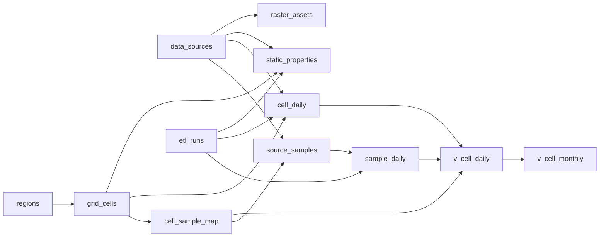

# Dicionário de dados — Agro Data Pipeline

**Referência:** 14/11/2026. **Banco:** Supabase `desafio nasa` (`mzjdsbubxyrxcgnbylgs`). **Schema:** `agro` (PostGIS instalado em `extensions`). Este documento descreve as migrações e extratores deste repositório e distingue dados já gravados de fontes apenas cadastradas. As contagens abaixo são um retrato: a carga histórica IMERG pode alterá-las.

## Convenções e granularidade

- A região `RO_250` é um quadrado de 250 × 250 km, centrado em longitude -60,960611111 e latitude -12,379388889. Geometrias do banco usam UTM **EPSG:32720**; longitude/latitude de `source_samples` estão em graus WGS84.
- A malha tem **100 células de nível 1** (25 × 25 km, IDs `M_rr_cc`) e **400 de nível 2** (12,5 × 12,5 km, IDs `S_rr_cc`). As séries e as propriedades importadas referem-se às células de nível 2. O tamanho da célula não melhora a resolução da fonte.
- `observed_on` é a data do produto diário; as requisições POWER usam padrão temporal UTC. `month` é o primeiro dia do mês. Timestamps de auditoria são `timestamptz`.
- `value` é sempre numérico (`double precision`); seu significado depende de `metric`, `unit`, `source_id` e, para solo, da profundidade. Chaves compostas permitem reprocessamento por `ON CONFLICT DO UPDATE`.
- `quality = estimated` é o valor escrito pelos extratores atuais. **Não** equivale a uma nota de precisão validada em campo. `NULL` em campos opcionais significa ausência de informação, não zero.

## Fontes cadastradas

| `source_id` | Provedor / produto | Resolução declarada no catálogo | Destino e estado em 14/11/2026 | Cuidados de interpretação |
|---|---|---|---|---|
| `POWER` | NASA [POWER Daily AG](https://power.larc.nasa.gov/docs/services/api/temporal/daily/) | ~0,5° meteorológica | `source_samples`, `sample_daily`, mapeamento a `v_cell_daily`; **524.490 observações** de 01/01/2020 a 12/11/2026 (as métricas têm datas finais diferentes) | 30 coordenadas representativas atendem 400 subcélulas. O agrupamento em bins de 0,5° é aproximação local; confirmar coordenadas/grade retornadas pelo provedor para uso científico rigoroso. |
| `IMERG_FINAL` | NASA GPM [IMERG PPS Final Run GIS](https://gpm.nasa.gov/data/directory/imerg-final-run-pps-research-gis) | 0,1° | `cell_daily`; **6.000 linhas** observadas na consulta deste documento, com carga histórica em andamento. Um ZIP piloto em `raster_assets` / Storage | Produto Final GIS V07 (arquivos V07B); requer acesso PPS. Cada valor é média dos pixels válidos que tocam a célula, não média ponderada por área. O inventário PPS identificou 2.100 dias entre 2020 e 30/09/2025; não encontrou GIS Final de 01/10/2025 a 14/11/2026. |
| `SOILGRIDS` | ISRIC [SoilGrids](https://files.isric.org/soilgrids/latest/data/) | 250 m | Importador GeoTIFF para `static_properties` implementado; **0 linhas** | Arquivo, banda, profundidade, unidade e fator de escala são informados pelo operador. Valores regionais não substituem análise de solo da propriedade. |
| `SRTM` | NASA/USGS SRTM elevation | ~30 m | Importador GeoTIFF para `static_properties` implementado; **0 linhas** | O importador calcula média de elevação se essa métrica for escolhida. Não calcula declividade. |
| `FAO_HWSD` | FAO Harmonized World Soil Database | Varia | Cadastrada e aceita pelo importador estático; **0 linhas** | É preciso escolher e validar campo, unidade, raster e escala antes da carga. |
| `SMAP_L4` | NASA SMAP SPL4SMGP 007 | 9 km | Cadastrada; sem extrator ou dados | Umidade do solo ainda não é medida pelo pipeline. |
| `GLDAS` | NASA GLDAS Noah 0.25 v2.1 | 0,25° | Cadastrada; sem extrator ou dados | Evapotranspiração e déficit hídrico ainda não são calculados. |

O inventário diário de disponibilidade IMERG está em [imerg_availability_2020_2026-11-14.csv](imerg_availability_2020_2026-11-14.csv). O estado de carga é verificável por `agro.etl_runs` e pela contagem das tabelas; **disponível no PPS** não significa **já gravado no banco**. A precipitação POWER e a IMERG têm procedência e métodos distintos e permanecem em séries separadas por `source_id` e `metric`.

## Dicionário das métricas implementadas

| Fonte / parâmetro bruto | `metric` | Unidade armazenada | Grão de gravação | Cálculo na view mensal |
|---|---|---|---|---|
| POWER `T2M` | `temp_mean_c` | `C` | Amostra/dia | Média dos dias disponíveis |
| POWER `T2M_MIN` | `temp_min_c` | `C` | Amostra/dia | Média das mínimas diárias disponíveis; não é a mínima absoluta do mês |
| POWER `T2M_MAX` | `temp_max_c` | `C` | Amostra/dia | Média das máximas diárias disponíveis; não é a máxima absoluta do mês |
| POWER `RH2M` | `humidity_pct` | `%` | Amostra/dia | Média dos dias disponíveis |
| POWER `WS2M` | `wind_2m_m_s` | `m/s` | Amostra/dia | Média dos dias disponíveis |
| POWER `ALLSKY_SFC_SW_DWN` | `solar_mj_m2_day` | `MJ/m2/day` | Amostra/dia | Média dos dias disponíveis |
| POWER `PRECTOTCORR` | `precip_power_mm` | `mm` | Amostra/dia | Soma dos dias disponíveis |
| IMERG GIS `total.accum.tif` | `precip_mm` | `mm` | Subcélula/dia | Soma dos dias disponíveis |

O extrator POWER descarta valores ausentes (`NULL` ou código até -900). No IMERG, cada contagem válida do GeoTIFF corresponde a **0,1 mm**; pixels mascarados, negativos ou com código **29999** são excluídos. A média usa pixels que tocam o polígono (`all_touched=True`); `valid_fraction` mede a fração de pixels tocados que eram válidos. Quando não há pixels válidos, a célula não recebe linha naquele dia.

O importador de raster estático aceita `metric` e `unit` livres. Os nomes abaixo são **exemplos de operação documentados**, não uma enumeração imposta pelo banco:

| Fonte / banda de exemplo | `metric` | Unidade após escala | Profundidade | Situação |
|---|---|---|---|---|
| SoilGrids `phh2o` | `soil_ph` | `pH` | Ex.: 0–5 cm | Exemplo: `--scale 0.1`; não carregado |
| SRTM elevação | `elevation_m` | `m` | 0–0 cm (não aplicável) | Exemplo: `--scale 1`; não carregado |

Textura (`clay`, `sand`, `silt`) exigiria bandas, unidades e conversão conferidas no produto. Este pipeline não fornece P, K, Ca, Mg em nível de talhão, capacidade de campo, umidade do solo ou balanço hídrico. A recomendação agronômica depende também de medidas e manejo locais.

## Relações entre as tabelas

As tabelas abaixo pertencem ao schema `agro`. `PK` = chave primária, `FK` = chave estrangeira, `NN` = `NOT NULL`. Colunas não marcadas `NN` aceitam `NULL`. Os tipos `geometry` incluem tipo espacial e SRID.

### `regions` — área de trabalho

**Grão/chave:** uma linha por `region_id`.

| Campo | Tipo / regra | Significado |
|---|---|---|
| `region_id` | `text`, PK | Código da região; atual: `RO_250`. |
| `description` | `text`, NN | Descrição textual da região. |
| `center` | `geometry(Point,32720)`, NN | Centro em metros UTM. |
| `geom` | `geometry(Polygon,32720)`, NN | Limite da região. |
| `epsg` | `integer`, NN, padrão `32720` | Código EPSG declarado. |
| `created_at` | `timestamptz`, NN, padrão `now()` | Inclusão do registro. |

### `grid_cells` — malha espacial

**Grão/chave:** uma linha por `cell_id`. `UNIQUE(region_id, level, row_index, col_index)`; índice espacial GiST em `geom`.

| Campo | Tipo / regra | Significado |
|---|---|---|
| `cell_id` | `text`, PK | `M_rr_cc` para nível 1; `S_rr_cc` para nível 2. |
| `region_id` | `text`, NN, FK `regions` | Região à qual a célula pertence. |
| `parent_id` | `text`, FK `grid_cells` | Célula mãe; `NULL` no nível 1. |
| `level` | `smallint`, NN, `1` ou `2` | Nível da malha. |
| `row_index` | `smallint`, NN | Índice da linha, iniciado em zero. |
| `col_index` | `smallint`, NN | Índice da coluna, iniciado em zero. |
| `geom` | `geometry(Polygon,32720)`, NN | Quadrado da célula em metros UTM. |

### `data_sources` — catálogo de produtos

**Grão/chave:** uma linha por `source_id`. Cadastro não implica ingestão.

| Campo | Tipo / regra | Significado |
|---|---|---|
| `source_id` | `text`, PK | Código usado nas tabelas de dados. |
| `provider` | `text`, NN | Instituição provedora. |
| `product` | `text`, NN | Nome do produto. |
| `version` | `text` | Versão declarada, se houver. |
| `url` | `text` | Página de referência do produto. |
| `native_resolution` | `text` | Resolução descrita no catálogo; texto informativo. |
| `description` | `text` | Uso previsto ou observações. |
| `created_at` | `timestamptz`, NN, padrão `now()` | Inclusão do catálogo. |

### `etl_runs` — execução e rastreabilidade

**Grão/chave:** uma linha por execução (`run_id`). Uma tentativa falha fica registrada com `status = failed` e mensagem em `error`.

| Campo | Tipo / regra | Significado |
|---|---|---|
| `run_id` | `bigint` identity, PK | Identificador da execução. |
| `command` | `text`, NN | Comando lógico, como `power_daily`, `imerg_daily` ou `static_raster`. |
| `source_id` | `text`, FK `data_sources` | Fonte processada; opcional para comandos gerais. |
| `period_start` | `date` | Primeiro dia solicitado, quando aplicável. |
| `period_end` | `date` | Último dia solicitado, quando aplicável. |
| `status` | `text`, NN, padrão `running`; `running`, `succeeded`, `failed` | Resultado da execução. |
| `records_written` | `integer`, NN, padrão `0` | Quantidade reportada pelo ETL; inclui linhas atualizadas em reprocessamentos. |
| `error` | `text` | Mensagem de falha, se houver. |
| `started_at` | `timestamptz`, NN, padrão `now()` | Início. |
| `ended_at` | `timestamptz` | Fim, preenchido ao finalizar. |

### `source_samples` — pontos consultados na fonte

**Grão/chave:** uma linha por `sample_id`; `UNIQUE(source_id, native_key)`. Há 30 amostras POWER cadastradas.

| Campo | Tipo / regra | Significado |
|---|---|---|
| `sample_id` | `bigint` identity, PK | Identificador interno da amostra. |
| `source_id` | `text`, NN, FK `data_sources` | Produto consultado, atualmente `POWER`. |
| `native_key` | `text`, NN | Chave deduplicada gerada para a coordenada representativa. Não confirma a célula nativa escolhida internamente pelo POWER. |
| `lon` | `double precision`, NN | Longitude enviada à API, graus WGS84. |
| `lat` | `double precision`, NN | Latitude enviada à API, graus WGS84. |

### `cell_sample_map` — amostra associada à subcélula

**Grão/chave:** par (`cell_id`, `sample_id`). Atualmente, cada uma das 400 subcélulas aponta a uma amostra POWER com peso 1.

| Campo | Tipo / regra | Significado |
|---|---|---|
| `cell_id` | `text`, NN, FK `grid_cells`, PK parcial | Célula que recebe o valor. |
| `sample_id` | `bigint`, NN, FK `source_samples`, PK parcial | Ponto consultado. |
| `weight` | `double precision`, NN, padrão `1`, intervalo `(0,1]` | Multiplicador aplicado em `v_cell_daily`; o banco não exige que pesos de múltiplas amostras somem 1. |

### `sample_daily` — observação diária por ponto

**Grão/chave:** (`sample_id`, `observed_on`, `metric`). Atualmente recebe POWER; 524.490 linhas no retrato de 14/11/2026.

| Campo | Tipo / regra | Significado |
|---|---|---|
| `sample_id` | `bigint`, NN, FK `source_samples`, PK parcial | Ponto de origem. |
| `observed_on` | `date`, NN, PK parcial | Dia do dado. |
| `metric` | `text`, NN, PK parcial | Código da variável da tabela de métricas. |
| `value` | `double precision`, NN | Valor diário já na unidade indicada. |
| `unit` | `text`, NN | Unidade de `value`. |
| `quality` | `text`, NN, padrão `estimated` | Rótulo de qualidade informado pelo ETL. |
| `run_id` | `bigint`, FK `etl_runs` | Última execução que inseriu/atualizou a linha. |

### `cell_daily` — observação diária espacializada

**Grão/chave:** (`cell_id`, `source_id`, `observed_on`, `metric`). Atualmente recebe IMERG; 6.000 linhas no retrato de 14/11/2026. Índice em (`observed_on`, `metric`).

| Campo | Tipo / regra | Significado |
|---|---|---|
| `cell_id` | `text`, NN, FK `grid_cells`, PK parcial | Subcélula agregada. |
| `source_id` | `text`, NN, FK `data_sources`, PK parcial | Fonte do raster diário. |
| `observed_on` | `date`, NN, PK parcial | Dia do produto. |
| `metric` | `text`, NN, PK parcial | Variável; hoje `precip_mm`. |
| `value` | `double precision`, NN | Média dos pixels válidos tocados pela subcélula, em mm. |
| `unit` | `text`, NN | Unidade; hoje `mm`. |
| `quality` | `text`, NN, padrão `estimated` | Rótulo do ETL. |
| `valid_fraction` | `double precision`, intervalo `[0,1]` | Proporção de pixels tocados com valor válido; pode ser `NULL` para outros produtos. |
| `run_id` | `bigint`, FK `etl_runs` | Última execução que inseriu/atualizou a linha. |

### `static_properties` — atributos de solo e relevo

**Grão/chave:** (`cell_id`, `source_id`, `metric`, `depth_top_cm`, `depth_bottom_cm`). **Sem linhas** no retrato de 14/11/2026.

| Campo | Tipo / regra | Significado |
|---|---|---|
| `cell_id` | `text`, NN, FK `grid_cells`, PK parcial | Subcélula agregada. |
| `source_id` | `text`, NN, FK `data_sources`, PK parcial | Produto de origem. |
| `metric` | `text`, NN, PK parcial | Nome dado pelo operador à propriedade. |
| `depth_top_cm` | `integer`, NN, padrão `0`, PK parcial | Limite superior da camada, cm. |
| `depth_bottom_cm` | `integer`, NN, padrão `0`, PK parcial | Limite inferior da camada, cm; 0–0 para relevo ou campo sem profundidade. |
| `value` | `double precision`, NN | Média dos pixels válidos multiplicada por `--scale`. |
| `unit` | `text`, NN | Unidade declarada pelo operador. |
| `quality` | `text`, NN, padrão `estimated` | Rótulo do ETL. |
| `run_id` | `bigint`, FK `etl_runs` | Última execução que inseriu/atualizou a linha. |

O schema não restringe métricas, profundidades ou unidades. Portanto, uma importação só é interpretável quando o arquivo, o fator de escala e a camada forem conferidos com a documentação da fonte. O método espacial também usa pixels tocados (`all_touched=True`) e média simples.

### `raster_assets` — arquivos no Storage

**Grão/chave:** uma linha por `asset_id`; `object_key` único. Há um ZIP IMERG piloto arquivado; o backfill padrão não arquiva cada ZIP bruto.

| Campo | Tipo / regra | Significado |
|---|---|---|
| `asset_id` | `bigint` identity, PK | Identificador do arquivo. |
| `source_id` | `text`, NN, FK `data_sources` | Fonte do arquivo. |
| `observed_on` | `date` | Dia do produto, quando aplicável. |
| `object_key` | `text`, NN, único | Caminho do objeto no bucket privado `agro-rasters`; não é URL pública. |
| `sha256` | `text`, NN | Hash SHA-256 do arquivo armazenado. |
| `bytes` | `bigint`, NN | Tamanho em bytes. |
| `format` | `text`, NN | Formato informado pelo adaptador de armazenamento. |
| `created_at` | `timestamptz`, NN, padrão `now()` | Inclusão do registro. |

### `schema_migrations` — controle de migrações

Criada pelo código de `src/agro/db.py`, fora da migração SQL inicial. **Grão/chave:** uma linha por arquivo aplicado.

| Campo | Tipo / regra | Significado |
|---|---|---|
| `filename` | `text`, PK | Nome da migração executada. |
| `applied_at` | `timestamptz`, NN, padrão `now()` | Momento da aplicação. |

## Views de consulta

### `v_cell_daily` — série diária por subcélula

Une `sample_daily` às subcélulas via `cell_sample_map` e inclui `cell_daily`, **somente nível 2**. Preserva `source_id`. Para amostras, `value = sample_daily.value × weight` e `method = sample`; para rasters diários, `value = cell_daily.value` e `method = zonal_mean`. A view não expõe `valid_fraction` nem `run_id`.

| Campo | Tipo | Significado |
|---|---|---|
| `cell_id` | `text` | Subcélula. |
| `source_id` | `text` | Fonte do dado. |
| `observed_on` | `date` | Dia. |
| `metric` | `text` | Variável. |
| `value` | `double precision` | Valor projetado ou agregado. |
| `unit` | `text` | Unidade do valor. |
| `quality` | `text` | Rótulo original da tabela diária. |
| `method` | `text` | `sample` ou `zonal_mean`. |

Se uma célula receber mais de uma amostra para a mesma fonte, data e métrica no futuro, a view poderá emitir mais de uma linha: ela não faz soma dos pesos nem garante unicidade nesse conjunto de colunas.

### `v_cell_monthly` — agregação mensal

Agrega `v_cell_daily` por célula, fonte, primeiro dia do mês, métrica e unidade. `precip_mm` e `precip_power_mm` são somadas; as demais métricas são médias. Não exige um número mínimo de dias.

| Campo | Tipo | Significado |
|---|---|---|
| `cell_id` | `text` | Subcélula. |
| `source_id` | `text` | Fonte preservada na agregação. |
| `month` | `date` | Primeiro dia do mês de referência. |
| `metric` | `text` | Variável. |
| `unit` | `text` | Unidade. Para precipitação, a soma dos totais diários mantém `mm`. |
| `days_available` | `bigint` | Contagem de linhas diárias agrupadas; com o mapeamento atual de uma amostra por célula equivale a dias com dado. |
| `value` | `double precision` | Soma ou média calculada sobre as linhas disponíveis. |
| `aggregation` | `text` | `sum` ou `mean`. |

Para usar precipitação como **total mensal**, compare `days_available` com os dias do mês e trate meses incompletos antes de tomar decisões. POWER e IMERG não devem ser somados entre si. Para valores IMERG, consulte também `cell_daily.valid_fraction` quando a cobertura espacial importar.

## Estado da ingestão e lacunas

O retrato consultado em 14/11/2026 mostrou 500 células (100 + 400), 30 pontos POWER, 524.490 linhas em `sample_daily`, 6.000 em `cell_daily`, zero em `static_properties` e um arquivo em `raster_assets`. O maior `observed_on` de `sample_daily` era 12/11/2026; algumas métricas podem terminar antes. As 6.000 linhas IMERG iam de 01/01/2020 a 03/01/2024, **sem implicar cobertura contínua** entre essas datas. Use a verificação de histórico, não apenas `MIN`/`MAX`, para auditar lacunas.

No estado atual, nenhuma tabela armazena medidas de uma propriedade ou talhão específico (análise química de solo, textura medida, manejo, irrigação). A malha regional e os produtos remotos servem como contexto para recomendações, sujeitos à resolução e à cobertura de cada fonte. Consulte também [critérios de recomendação](criterios_recomendacao.md) e o [relatório de verificação](verificacao_2026-11-14.md).
